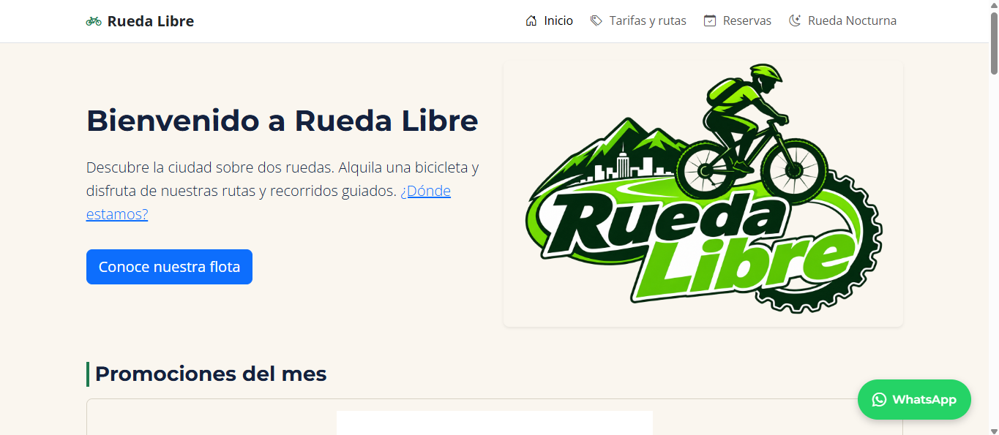
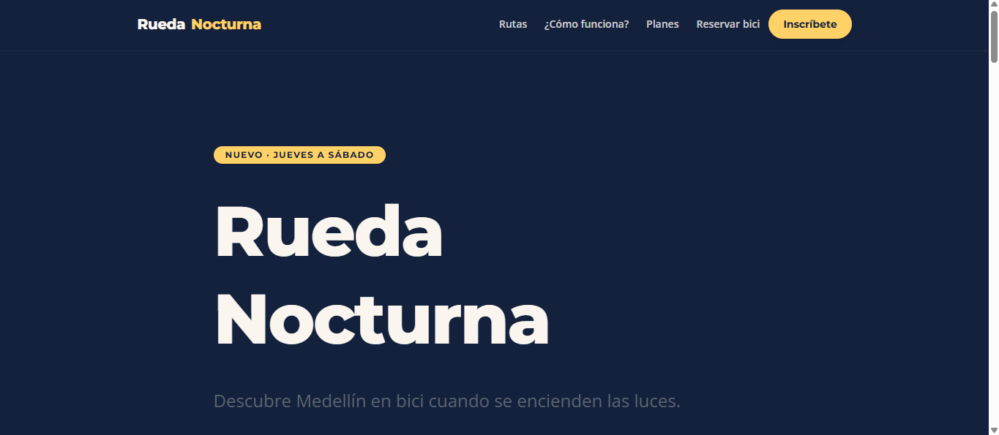

# 🚲 Rueda Libre - Sitio Web y Landing de Campaña

Proyecto de desarrollo web front-end para un negocio de alquiler de bicicletas en Medellín. El repositorio contiene dos productos integrados: el sitio informativo principal (construido con **Bootstrap**) y una landing de campaña (construida con **Tailwind CSS**).

## 🌐 Enlaces publicados (GitHub Pages)

**Sitio principal (Bootstrap):**
- [Inicio](https://danilotangarife.github.io/rueda_libre/index.html)
- [Tarifas y Rutas](https://danilotangarife.github.io/rueda_libre/paginas/tarifas.html)
- [Reservas](https://danilotangarife.github.io/rueda_libre/paginas/reservas.html)

**Landing de campaña (Tailwind CSS):**
- [Rueda Nocturna](https://danilotangarife.github.io/rueda_libre/nocturna/index.html)

*Repositorio: [https://github.com/DaniloTangarife/rueda_libre](https://github.com/DaniloTangarife/rueda_libre)*

## 🛠️ Tecnologías aplicadas

### Sitio principal (Bootstrap)
- **Bootstrap 5.3** (CDN): Navbar colapsable, Grid, Cards, Carrusel, Modal, Alertas y Validación de formularios.
- **Bootstrap Icons** para la iconografía.
- **CSS propio** (`css/styles.css`) para personalizar la paleta de colores y tipografías de la marca sobre las variables de Bootstrap.
- **JavaScript** (Bootstrap Bundle) para la interactividad (menú hamburguesa, carrusel, modal).

### Landing de Campaña (Tailwind CSS)
- **Tailwind CSS v4** (instalado con CLI, sin CDN en producción).
- **@theme** para definir los colores y fuentes de la marca.
- **@apply** para reutilizar componentes (botones y etiquetas).
- **Modo oscuro** (dark mode) integrado con la preferencia del sistema.
- **Responsive** mobile-first usando prefijos `sm:`, `md:`, `lg:`.

## 📂 Estructura básica
- `index.html` y `paginas/`: Páginas del sitio principal (Bootstrap).
- `nocturna/`: Landing de la campaña (Tailwind).
- `css/styles.css`: Estilos personalizados del sitio principal.
- `img/`: Imágenes del proyecto.

## 📸 Capturas

## 👤 Autor

**Danilo Tangarife**
Estudiante de Riwi - Módulo de Desarrollo Web Front-end.
- GitHub: [@DaniloTangarife](https://github.com/DaniloTangarife)