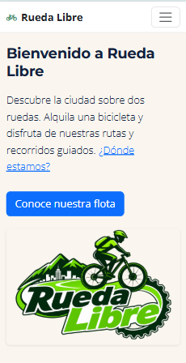

# 🚲 Rueda Libre y Rueda Nocturna - Ecosistema Web

Proyecto de desarrollo web front-end para un negocio de alquiler de bicicletas en Medellín. El repositorio contiene **dos productos integrados**:

1. **Sitio principal (Bootstrap 5.3):** Páginas informativas, tarifas, reservas y landing integrada.
2. **Landing de campaña (Tailwind CSS v4):** Página de la campaña "Rueda Nocturna" con tema propio y modo oscuro.

> **Nota para la entrega:** Este mismo repositorio se entrega en las dos tareas (Bootstrap y Tailwind). El sitio principal usa **Bootstrap** y la carpeta `nocturna/` usa **Tailwind CSS**. En este README se detalla qué se aplicó con cada tecnología.

## 🌐 Enlaces publicados (GitHub Pages)

**Sitio principal (Bootstrap):**
- [Inicio](https://danilotangarife.github.io/rueda_libre/index.html)
- [Tarifas y Rutas](https://danilotangarife.github.io/rueda_libre/paginas/tarifas.html)
- [Reservas](https://danilotangarife.github.io/rueda_libre/paginas/reservas.html)

**Landing de campaña (Tailwind CSS):**
- [Rueda Nocturna](https://danilotangarife.github.io/rueda_libre/nocturna/index.html)

**Repositorio:** [https://github.com/DaniloTangarife/rueda_libre](https://github.com/DaniloTangarife/rueda_libre)

## 📂 Estructura del repositorio

rueda_libre/
├── index.html # Inicio del sitio (Bootstrap)
├── paginas/
│ ├── tarifas.html # Tarifas y rutas (Bootstrap)
│ └── reservas.html # Formulario de reservas (Bootstrap)
├── css/
│ └── styles.css # Hoja de estilos propia del sitio (Bootstrap)
├── img/ # Imágenes del proyecto (incluye capturas/)
├── pruebas/
│ └── catalogo-bootstrap.html # Prueba comparativa con Bootstrap
├── nocturna/ # LANDING CON TAILWIND
│ ├── index.html # Landing principal
│ ├── componentes.html # Kit de componentes
│ ├── prototipo.html # Prototipo inicial (Play CDN)
│ └── src/
│ ├── input.css # Tema con @theme y @apply
│ └── output.css # CSS generado y minificado
├── bitacora.txt # Bitácora de proceso
└── README.md # Este archivo

## 🛠️ Tecnologías aplicadas

### Bootstrap 5.3 (Sitio principal)
- **Navbar colapsable** con `navbar-expand-lg`, `collapse` y `aria-current`.
- **Grid** (`container`, `row`, `col-*`, `g-*`) en portada, flota, rutas, tarifas y reservas.
- **Cards** (`card`, `card-img-top`, `card-body`, `h-100`) en flota y rutas.
- **Carrusel** (`carousel`, `carousel-item`, `data-bs-ride`) con 4 slides y controles accesibles.
- **Modal** de políticas en reservas.
- **Alertas** dismissibles (`alert-dismissible`, `btn-close`).
- **Formulario con validación visual** (`needs-validation`, `invalid-feedback`, script oficial).
- **Variables `--bs-*`** sobrescritas en `styles.css` para la identidad de marca.
- **Bootstrap Icons** con `aria-hidden` y `aria-label`.

### Tailwind CSS v4 (Landing Nocturna)
- **`@theme`** en `input.css` para definir los 6 colores de marca y las tipografías.
- **Utilidades** de layout, espaciado, tipografía y color en toda la landing.
- **Responsive mobile-first** con prefijos `sm:`, `md:`, `lg:`.
- **Modo oscuro** con la variante `dark:` (preferencia del sistema).
- **`@apply`** para 3 clases de componentes: `.btn-primary`, `.btn-secondary`, `.badge-level`.
- **HTML limpio** sin estilos en línea (`style=""`) ni etiquetas `<style>`.

## 🎨 Identidad de marca compartida

| Color | Código | Uso |
|-------|--------|-----|
| Verde Ruta | `#1E7A4F` | Botones principales, enlaces. |
| Naranja Pedal | `#F39A2B` | Destacados, botones secundarios. |
| Azul Noche | `#14213D` | Títulos y encabezado. |
| Crema | `#FAF6EF` | Fondo general. |
| Gris Asfalto | `#5B6470` | Texto secundario. |
| Amarillo Farol | `#FFD166` | Color exclusivo de la campaña Nocturna. |

**Tipografías:** Montserrat (títulos) y Open Sans (textos) en ambos productos.

## 📱 Responsive

- **Sitio principal:** Probado a 360px, 768px y 1280px. Sin scroll horizontal.
- **Landing:** Probado a 360px, 768px, 1024px y 1280px. Grids adaptables (`sm:grid-cols-2`, `lg:grid-cols-3/4`).

## ♿ Accesibilidad

- Estructura semántica en ambos productos.
- Textos `alt` descriptivos en todas las imágenes.
- Navegación completa con teclado (Tab, Enter, Espacio).
- Contraste WCAG AA en todas las combinaciones de texto y fondo.
- `aria-current="page"`, `aria-label`, `aria-hidden` en íconos decorativos.

## 📸 Capturas

### Sitio principal (Bootstrap)

### Landing Nocturna (Tailwind)

### Vista móvil (360px)

## 📚 Aprendizajes clave

1. **Semántica y accesibilidad:** Uso de etiquetas HTML5, jerarquía de encabezados y contraste WCAG.
2. **Responsive design:** Mobile-first, Flexbox, Grid y utilidades de frameworks.
3. **Validación de formularios:** Combinación de validación nativa y visual (Bootstrap).
4. **Frameworks CSS:** Comparación práctica entre Bootstrap (componentes) y Tailwind (utility-first).
5. **Trabajo bajo presión:** Resolución de requerimientos en tiempo limitado.
6. **Documentación y publicación:** GitHub Pages y README profesional.

## 👤 Autor

**Danilo Tangarife**
Estudiante de Riwi - Módulo de Desarrollo Web Front-end.
- GitHub: [@DaniloTangarife](https://github.com/DaniloTangarife)